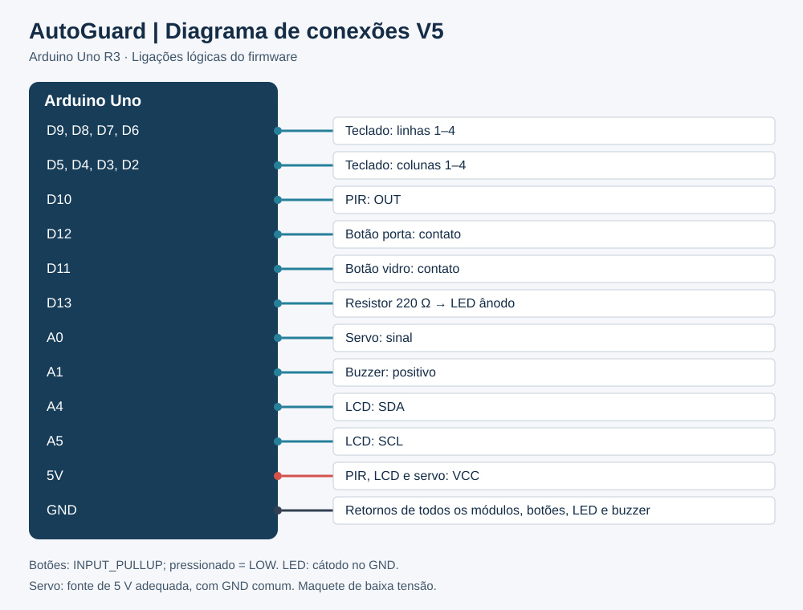
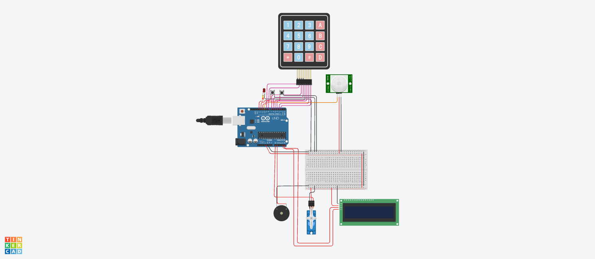

# AutoGuard: Segurança automotiva além da chave

> Projeto prático de IoT e Segurança da Informação desenvolvido na disciplina de Algoritmos e Estrutura de Dados (CESAR School).

## 👥 Integrantes da Equipe
- **Maria Bianca** — rodriguesbianca123123@gmail.com
- **Laura Júlia** — laurantos2020@gmail.com
- **Bruna Mylena** — bruna.gracianno97@gmail.com
- **Maria Letícia** — mleticiarmonteiro2004@gmail.com

---

## 📖 1. Contexto e História (O Problema)
Sistemas de segurança automotiva podem estar sujeitos a tentativas de acesso indevido, abertura de portas, violação de vidros e presença não autorizada no interior do veículo. O AutoGuard propõe uma maquete de proteção local que integra sensores e atuadores a um Arduino Uno. O sistema monitora o ambiente quando armado, aciona alertas sonoros e visuais diante de uma violação e exige duas credenciais para desarmar a proteção. A limitação de tentativas dificulta ataques por tentativa e erro.

## ⚙️ 2. Funcionalidades do Dispositivo
Os itens marcados representam funcionalidades implementadas no código V5, não necessariamente validadas na placa física.
- [x] Armar pelo teclado (A), com contagem regressiva de 5 segundos.
- [x] Detecção de abertura de porta, violação de vidro (simuladas por botões) e movimento por PIR.
- [x] Sirene, LED intermitente e indicação da causa no LCD.
- [x] Travamento e destravamento por servo motor.
- [x] Autenticação em duas etapas: código mestre e senha.
- [x] Bloqueio de 30 segundos após três credenciais incorretas, mantendo a vigilância.
- [x] Comparação de hashes DJB2 de 32 bits com sal fixo, sem credenciais em texto puro no firmware.
- [x] Debounce de 40 ms nos botões, aquecimento inicial do PIR de 5 s na simulação e expiração da autenticação após 20 s de inatividade.
- [x] Registro de eventos no Monitor Serial.
- [ ] Validação integrada das funcionalidades de segurança da V5.
- [ ] Montagem e validação na placa física.

Não há RFID, segundo fator independente, Wi-Fi, Bluetooth, MQTT ou cifragem de dados nesta versão. DJB2 é um hash didático, não criptográfico. O bloqueio é volátil e pode ser perdido ao reiniciar o Arduino. Trata-se de protótipo acadêmico local, não de alarme comercial conectado.

## 🛠️ 3. Especificações Técnicas e Componentes
- **Microcontrolador:** Arduino Uno R3 (ATmega328P).
- **Entradas:** teclado matricial 4×4, dois botões e sensor PIR.
- **Saídas:** LCD 16×2 I2C, buzzer piezo, LED vermelho com resistor de 220 Ω e servo motor.
- **Montagem:** protoboard, jumpers e alimentação de 5 V.
- **Ambiente:** Tinkercad Circuits e Arduino IDE para gravação física.
- **Framework:** Arduino, linguagem C/C++.
- **Bibliotecas:** Servo e Adafruit_LiquidCrystal. A leitura do teclado é implementada diretamente no código.

## 🔌 4. Diagrama de Conexões (Pinout)




A tabela abaixo reflete os pinos usados na V5, que substituem a pinagem inicial do projeto. A captura do Tinkercad documenta o circuito de referência no simulador. O [pinout detalhado](documentacao/pinout.md) e o [diagrama de ligações](esquematico/pinout.svg) representam a configuração lógica da V5.

| Componente | Pino do componente | Arduino Uno | Observações |
| :--- | :--- | :--- | :--- |
| Teclado 4×4 | Linhas 1–4 | D9, D8, D7, D6 | Varredura matricial |
| Teclado 4×4 | Colunas 1–4 | D5, D4, D3, D2 | INPUT_PULLUP |
| Sensor PIR | OUT | D10 | HIGH indica movimento |
| Sensor PIR | VCC / GND | 5V / GND | Alimentação |
| Botão da porta | Contato / retorno | D12 / GND | LOW quando pressionado |
| Botão do vidro | Contato / retorno | D11 / GND | LOW quando pressionado |
| LED vermelho | Ânodo / cátodo | D13 / GND | Resistor de 220 Ω em série |
| Servo motor | Sinal | A0 | 0° destravado; 90° travado |
| Servo motor | VCC / GND | 5V / GND | Fonte externa de 5V se necessário, com GND comum |
| Buzzer piezo | Positivo / negativo | A1 / GND | tone() |
| LCD I2C | SDA | A4 | Dados |
| LCD I2C | SCL | A5 | Clock |
| LCD I2C | VCC / GND | 5V / GND | Alimentação |

## 🚀 5. Instruções de Compilação e Gravação
1. Clone o repositório:
   ```bash
   git clone https://github.com/Biancaxr/AutoGuard.git
   cd AutoGuard
   ```
2. No Tinkercad, abra o circuito, selecione Código → Texto e cole o conteúdo de `codigo/alarme_v5/alarme_v5.ino`.
3. Inicie a simulação e aguarde 5 segundos.
4. Para a placa física, abra o arquivo `.ino` no Arduino IDE, instale as bibliotecas Servo e Adafruit LiquidCrystal, selecione Arduino Uno e a porta serial, compile e grave. Confirme a compatibilidade do módulo LCD: `Adafruit_LiquidCrystal lcd(0)` é a configuração usada no simulador; módulos I2C PCF8574 comuns podem exigir outra biblioteca e endereço. Ajuste o aquecimento do PIR real conforme seu módulo (frequentemente 30–60 s), tanto na condição de armar quanto na leitura do PIR. Esses ajustes e a gravação física ainda não foram validados.
5. Abra o Monitor Serial a 9600 baud. Consulte também o [guia de montagem física](documentacao/montagem-fisica.md).

## 🧪 6. Operação e testes
Credenciais públicas de demonstração: código mestre `246810`, senha `1234`. Não reutilizar em aplicações reais.

| Ação | Resultado esperado |
| :--- | :--- |
| A após aquecimento | Contagem de 5 s e servo em 90° |
| Pressionar botão de porta ou vidro, ou mover objeto no PIR | Sirene contínua, LED piscando e causa no LCD |
| D → 246810# → 1234# | Desarme e servo em 0° |
| D → 000000# (repetir três vezes) | Bloqueio de 30 s |
| Acionar sensor durante bloqueio | Alarme continua protegendo o veículo |
| Aguardar 30 s | Nova autenticação permitida |

Consulte o [roteiro e registro de testes](documentacao/testes.md). A tecla `*` apaga o último dígito. A tecla `#` confirma a entrada. O código usa `millis()` para os temporizadores e uma pausa curta de 30 ms na varredura.

## 🔐 7. Algoritmo central de segurança
O sistema passa pelos estados desarmado, armando, armado e disparado. A autenticação e o bloqueio são controlados separadamente, permitindo que os sensores continuem ativos durante essas operações. Cada credencial digitada é combinada com seu sal fixo e processada por DJB2; o resultado é comparado ao hash armazenado. Após três falhas, o teclado fica bloqueado por 30 segundos.

## 📸 8. Evidências e limitações
- Circuito de diagnóstico: componentes testados com sucesso no Tinkercad, conforme relato da equipe.
- V5: compilação/execução inicial bem-sucedida no simulador, conforme relato da equipe.
- Testes de segurança completos e montagem física: pendentes de evidências.
- Artigo Hackster.io: texto disponível em [artigo-hackster.md](documentacao/artigo-hackster.md); publicação pendente.

Utilizar apenas como maquete de baixa tensão. Não conectar diretamente à instalação elétrica de um veículo.
